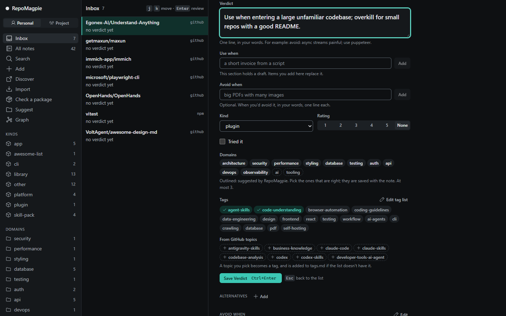
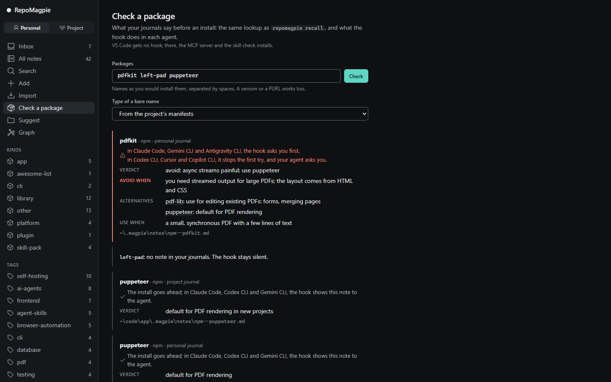
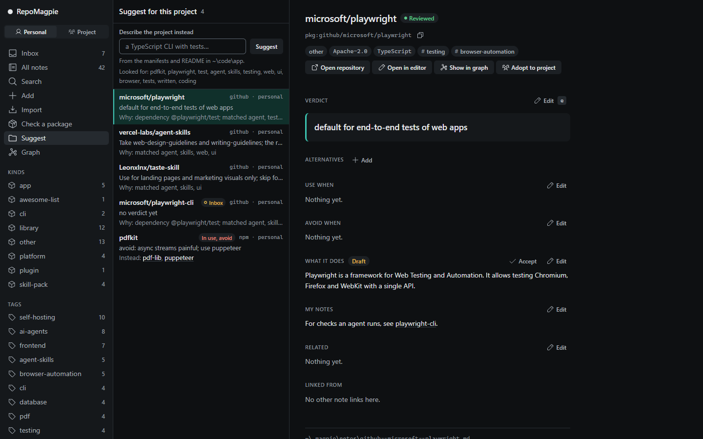
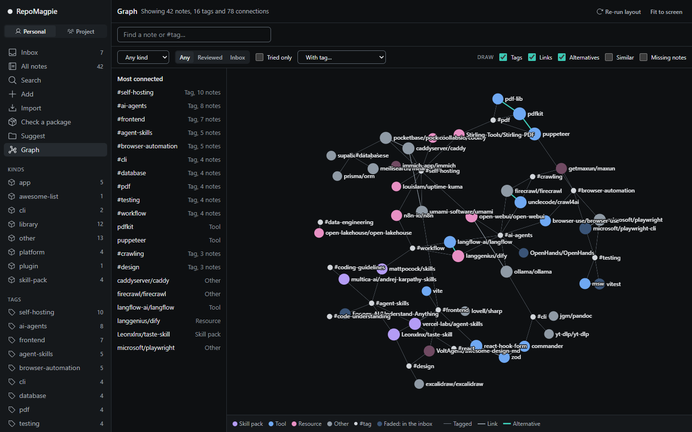

<div align="center">

**English** · [Türkçe](docs/readme/README_tr.md)


# RepoMagpie

### Your dependency notes, checked before your coding agent installs anything.

**Write down why you dropped a package. Your agent reads it before it installs that package again.**

[](https://www.npmjs.com/package/repomagpie)
[](docs/spec.md#repomagpie-mcp)
[](#what-each-agent-gets)
[](https://github.com/Varshavia/RepoMagpie/actions/workflows/ci.yml?query=branch%3Amain)
[](LICENSE)

[Quick start](#quick-start) · [How it works](#how-it-works) · [What each agent gets](#what-each-agent-gets) · [FAQ](#faq) · [Documentation](#documentation)

<code>npm install -g repomagpie@beta</code><br>
<code>repomagpie setup</code>

</div>

Months ago you tried pdfkit and gave up on it. Today your agent is about to install it again, and in Claude Code, RepoMagpie's hook asks you first, with your own note:

```text
$ npm install pdfkit

RepoMagpie: you noted to avoid pdfkit (personal journal)
Verdict: "avoid: async streams painful; use puppeteer"
Alternatives in your personal journal: "puppeteer" (Verdict: "default for PDF rendering")
~/.magpie/notes/npm--pdfkit.md

Do you want to proceed?
```

- **Remember:** write a Verdict in one line, `repomagpie note pdfkit "avoid: async streams painful; use puppeteer"`. Your agent also offers, once at a task's end, to save a dependency decision with your reason. Notes are Markdown files you own.
- **Recall before install:** when your agent runs `npm install pdfkit`, it sees your note first.
- **Find by concern:** ask about security, databases, testing… in any language, and your agent finds the notes that fit, even ones with no word in common.
- **Suggest:** `repomagpie suggest` reads a project's manifests and README, and lists the notes that fit it.
- **Discover:** search GitHub by words, concern and kind, with stars and recent activity, and add the repositories you choose to your inbox: `repomagpie discover`, or the app.
- **Start from a project:** `repomagpie init --auto` lists a project's dependencies by what your notes say, then asks for your Verdict on each one without a note.

**Status:** pre-release `0.2.0-beta.15`, for early testers. See the [changelog](CHANGELOG.md) and the [roadmap](docs/roadmap.md).

## Quick start

1. Install the `repomagpie` command and set it up in your coding agents:

   ```bash
   npm install -g repomagpie@beta
   repomagpie setup
   ```

   `setup` shows which files it will change, asks first, and backs up each file it edits; `repomagpie setup --dry-run` only shows the plan ([agents](docs/agents.md)).

2. Check what is wired in each agent:

   ```bash
   repomagpie doctor
   ```

   `doctor` also lists `setup`'s backups, which can hold your agents' secrets ([SECURITY.md](SECURITY.md#what-repomagpie-reads-writes-and-sends)); `repomagpie setup --delete-backups` deletes them.

3. Write your first note. A GitHub URL also fetches the repository's licence, topics and agent skills, and `--use-when` lets you find the note later by what you need:

   ```bash
   repomagpie note pdfkit "avoid: async streams painful; use puppeteer" --type npm
   repomagpie note https://github.com/microsoft/playwright-cli "use for agent browser tests" --use-when "an agent checks a web UI"
   ```

   GitHub allows 60 requests an hour without a token. To raise the limit: `export GITHUB_TOKEN=$(gh auth token)`, or in PowerShell `$env:GITHUB_TOKEN = gh auth token`.

> [!IMPORTANT]
> RepoMagpie comes only from [this repository](https://github.com/Varshavia/RepoMagpie), the npm package [`repomagpie`](https://www.npmjs.com/package/repomagpie) and the agent skill on [skills.sh](https://skills.sh/varshavia/repomagpie). There are no installers, no `.exe` or other downloads, no other packages and no other website: anything else that calls itself RepoMagpie is not ours ([SECURITY.md](SECURITY.md#official-channels)).

## How it works


Before an install, the skill tells your agent to call `recall`, the MCP tool or the `repomagpie recall` command. When a note says to avoid the package, your agent shows it to you and asks first. The hook checks the install command itself, in case the agent skips that step.

There is no extra model, no API key and no telemetry. RepoMagpie works as well as your agent follows the skill; without a hook, that includes the check before an install.

## Ask your agent

- **What do I have for browser testing?** Your agent searches your journals and answers with the notes it finds, Verdict first.
- **How should database security work in this project?** Your agent answers with your notes in the security and database domains that fit the project, and says why.
- **Install pdfkit.** Your agent recalls it first, shows your avoid note with its alternatives, and asks you before it installs anything.
- **Which of my tools fit this project?** `suggest` reads the project's manifests and README; your agent picks the notes that fit and names any dependency in use that you noted to avoid.

## What each agent gets

What `repomagpie setup` sets up in each agent, on Linux, Windows or macOS with Node.js 22.12 or later ([agents](docs/agents.md)):

| Agent | MCP | Skill | Hook | When a note says to avoid a package |
|---|---|---|---|---|
| Claude Code | yes | yes | yes | the hook asks you |
| Codex CLI | yes | yes | yes | the hook stops the first try; your agent asks you |
| Cursor | yes | yes | yes | the hook stops the first try; your agent asks you |
| Gemini CLI | yes | yes | yes | the hook asks you |
| VS Code (GitHub Copilot) | yes | yes | no | no hook; the MCP server and the skill check it |
| Antigravity CLI | yes | yes | yes | the hook asks you |
| Copilot CLI | yes | yes | yes | the hook stops the first try; your agent asks you |

Codex CLI runs a new hook only after you trust it in `/hooks`. Other agents with MCP or [Agent Skills](https://agentskills.io) can use the server or the skill: see [setting up by hand](docs/setup-by-hand.md). The package has no runtime dependencies, and paths with letters outside ASCII work.

## Share notes with your team

A project journal is a `.magpie/` folder in the repository, committed with the code. RepoMagpie's hook and `recall` read it for every contributor, next to each person's own journal.

```sh
repomagpie note pdfkit "avoid: async streams painful; use puppeteer" --to project
git add .magpie && git commit -m "Add our note on pdfkit"
```

Or copy one of your own notes there: `repomagpie adopt pdfkit`. When a teammate's agent is about to run `npm install pdfkit`, the hook asks them first, and their `search` and `suggest` find the note too. Anyone who can read the repository can read its notes.

## The local app

`repomagpie ui` opens your journals in the browser. Review an inbox note: write the Verdict, set kind, domains, tags and rating, and press Ctrl+Enter.



Check a package: what your journals say before an install, and what the hook does in each agent.



Suggest for this project: the notes that fit, and why each one is a candidate.



See a journal as a graph: notes, their tags, `[[links]]` and alternatives, coloured by domain if you choose. Click a note to read and edit it beside the graph.



## How it compares

| Tool | What it knows | When you see it |
|---|---|---|
| Star managers, such as [Starcat](https://github.com/starcat-app/Starcat) and [GithubStarsManager](https://github.com/AmintaCCCP/GithubStarsManager) | The repositories you starred, with tags and notes | When you search them later |
| Supply-chain scanners, such as [Socket Firewall Free](https://github.com/SocketDev/sfw-free) | Malware, vulnerabilities and popularity, from global data | Before an install |
| RepoMagpie | Your verdicts and your team's | Before an install, when you search, and when you start a project |

A line like "avoid pdfkit" in `CLAUDE.md` covers one project. A RepoMagpie note works across projects, shows up in search, and the hook checks it on every install. RepoMagpie isn't a scanner: it never claims to detect malware or vulnerabilities, so run one next to it ([vision](docs/vision.md#non-goals)).

## FAQ

<details>
<summary><strong>Does RepoMagpie send my notes anywhere?</strong></summary>

No. Your journals are Markdown files on your machine, and there is no telemetry. The only network requests are read-only calls to GitHub's API, when you add a note from a GitHub repository or search with `discover`: they send that repository's name or your search, and `GITHUB_TOKEN` if you set it, never your notes. `repomagpie ui` listens on `127.0.0.1` only. Your agent's model provider sees the notes your agent reads. See [SECURITY.md](SECURITY.md#what-repomagpie-reads-writes-and-sends).

</details>

<details>
<summary><strong>Does RepoMagpie use AI?</strong></summary>

Not a model of its own: its commands match names and words, and call no model. The AI is the coding agent you already use, which reads and saves your notes through the skill and the MCP tools. The skill tells it never to write your Verdict for you, never to delete a note you didn't name, and never to install a package you noted to avoid without asking you; a hook checks that last one too.

</details>

<details>
<summary><strong>Does the hook block installs?</strong></summary>

Never for good, and it never approves one. When a note says to avoid the package, the hook asks you, or stops the first try so that your agent asks you ([the table](#what-each-agent-gets)); after a stop, the same install goes through for 10 minutes. Any other note, or an error in RepoMagpie, never stops an install. See the [hook contract](docs/spec.md#6-hook-contract).

</details>

<details>
<summary><strong>How do I remove it?</strong></summary>

Run `repomagpie setup --remove`. It takes out only RepoMagpie's own MCP entries, hooks and skill folders, never restores a backup over your later changes, and leaves your journals and `setup`'s backups. Then `repomagpie setup --delete-backups` deletes the backups after asking, and `npm uninstall -g repomagpie` removes the command.

</details>

<details>
<summary><strong>Where are my notes, and can I edit them by hand?</strong></summary>

Each note is one Markdown file with YAML frontmatter, in `~/.magpie/notes/` or a project's `.magpie/notes/` ([note schema](docs/note-schema.md)). Edit them in any editor: RepoMagpie reads hand-written notes even with fields or sections missing, and never rewrites your sections. Set `MAGPIE_HOME` or pass `--home` to keep your journal elsewhere. `repomagpie delete` moves a note to the journal's `.trash/`.

</details>

## Documentation

- [Spec](docs/spec.md): every command, flag and `--json` document (`repomagpie --help` lists the commands)
- [Agents](docs/agents.md): what each coding agent supports, and [setting up by hand](docs/setup-by-hand.md)
- [Note schema](docs/note-schema.md): the format of a note
- [The local app](docs/ui.md): screens, API and security rules
- [Testing the beta](TESTING.md): the steps for a week with the beta, and how to send feedback
- [Vision](docs/vision.md), [competitors](docs/competitors.md) and [decisions](docs/decisions/)

Open an issue for bugs and ideas. The project doesn't take pull requests yet ([CONTRIBUTING.md](CONTRIBUTING.md)). To report a vulnerability, see [SECURITY.md](SECURITY.md).

## Licence

[MIT](LICENSE) © 2026 Yusuf Suat Babacan
