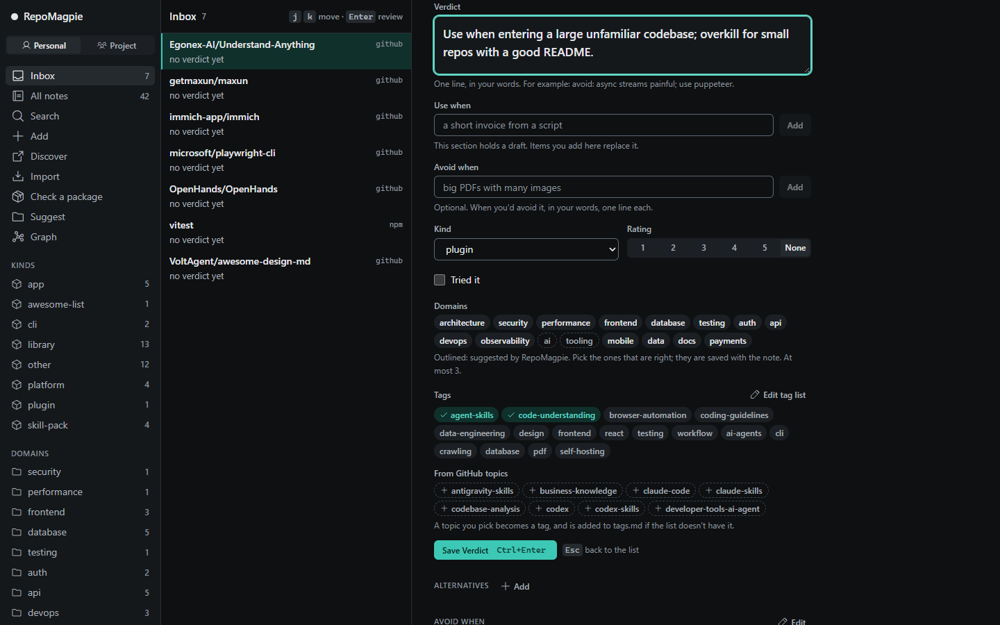
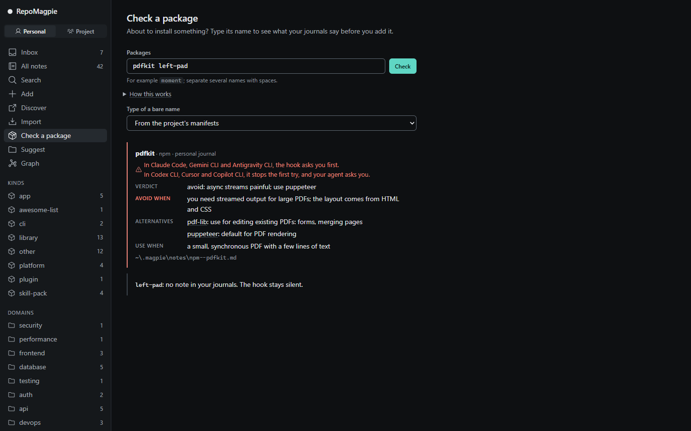
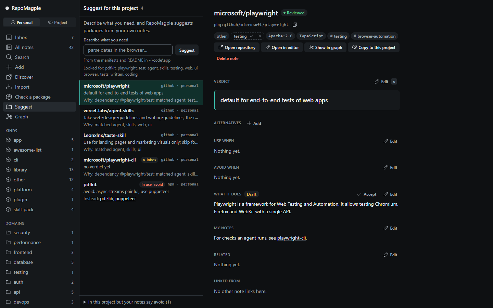
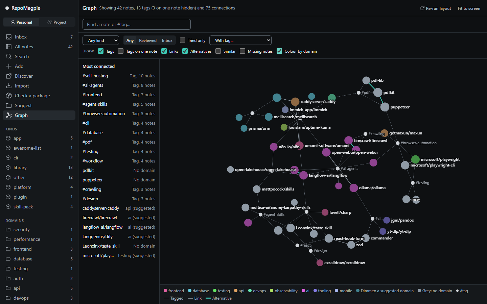

<div align="center">

[English](../../README.md) · [Türkçe](README_tr.md) · Deutsch · [Español](README_es.md) · [简体中文](README_zh-CN.md) · [日本語](README_ja.md)

_Dies ist eine Übersetzung des englischen README und kann ihm hinterherhinken; maßgeblich ist das englische README. Übersetzt vom englischen README mit Stand 2026-11-04._


# RepoMagpie

### Deine Notizen zu Abhängigkeiten, geprüft, bevor dein Coding-Agent etwas installiert.

**Schreib auf, warum du ein Paket aufgegeben hast. Dein Agent liest es, bevor er dieses Paket wieder installiert.**

[](https://www.npmjs.com/package/repomagpie)
[](../spec.md#repomagpie-mcp)
[](#was-jeder-agent-bekommt)
[](https://github.com/Varshavia/RepoMagpie/actions/workflows/ci.yml?query=branch%3Amain)
[](../../LICENSE)

[Schnellstart](#schnellstart) · [So funktioniert es](#so-funktioniert-es) · [Was jeder Agent bekommt](#was-jeder-agent-bekommt) · [FAQ](#faq) · [Dokumentation](#dokumentation)

<code>npm install -g repomagpie@beta</code><br>
<code>repomagpie setup</code>

</div>

Vor Monaten hast du pdfkit ausprobiert und aufgegeben. Heute will dein Agent es wieder installieren, und in Claude Code fragt dich der Hook von RepoMagpie zuerst, mit deiner eigenen Notiz:

```text
$ npm install pdfkit

RepoMagpie: you noted to avoid pdfkit (personal journal)
Verdict: "avoid: async streams painful; use puppeteer"
Alternatives in your personal journal: "puppeteer" (Verdict: "default for PDF rendering")
~/.magpie/notes/npm--pdfkit.md

Do you want to proceed?
```

- **Merken:** Schreib ein Verdict (dein Urteil) in einer Zeile: `repomagpie note pdfkit "avoid: async streams painful; use puppeteer"`. Dein Agent bietet außerdem einmal am Ende einer Aufgabe an, eine Entscheidung über eine Abhängigkeit mit deiner Begründung zu speichern. Notizen sind Markdown-Dateien, die dir gehören.
- **Erinnern vor der Installation:** Wenn dein Agent `npm install pdfkit` ausführt, sieht er zuerst deine Notiz.
- **Nach Thema finden:** Frag nach Sicherheit, Datenbanken, Tests … in jeder Sprache, und dein Agent findet die passenden Notizen, auch solche, die kein Wort mit deiner Frage gemeinsam haben.
- **Vorschlagen:** `repomagpie suggest` liest die Manifeste und das README eines Projekts und listet die Notizen auf, die dazu passen.
- **Entdecken:** Durchsuche GitHub nach Wörtern, Thema und Art, mit Sternen und letzter Aktivität, und füge die Repositorys, die du wählst, deiner inbox (Eingang) hinzu: `repomagpie discover` oder die App. Listen und Kurse bleiben ausgeblendet, wenn du nicht danach fragst, und jedes Ergebnis sagt, warum es da ist.
- **Bei einem Projekt anfangen:** `repomagpie init --auto` listet die Abhängigkeiten eines Projekts danach auf, was deine Notizen sagen, und fragt dann bei jeder ohne Notiz nach deinem Verdict.

**Status:** Beta, für erste Tester. Das [Changelog](../../CHANGELOG.md) listet jede Version auf; die [Roadmap](../roadmap.md) zeigt, was als Nächstes kommt.

## Schnellstart

1. Installiere den Befehl `repomagpie` und richte ihn in deinen Coding-Agents ein:

   ```bash
   npm install -g repomagpie@beta
   repomagpie setup
   ```

   `setup` zeigt, welche Dateien es ändern wird, fragt zuerst und sichert jede Datei, die es bearbeitet; `repomagpie setup --dry-run` zeigt nur den Plan ([Agents](../agents.md)).

2. Prüfe, was in jedem Agent eingerichtet ist:

   ```bash
   repomagpie doctor
   ```

   `doctor` listet auch die Sicherungen von `setup` auf, die Geheimnisse deiner Agents enthalten können ([SECURITY.md](../../SECURITY.md#what-repomagpie-reads-writes-and-sends)); `repomagpie setup --delete-backups` löscht sie.

3. Schreib deine erste Notiz. Eine GitHub-URL holt auch die Lizenz, die Topics und die Agent-Skills des Repositorys, und mit `--use-when` findest du die Notiz später über das, was du brauchst:

   ```bash
   repomagpie note pdfkit "avoid: async streams painful; use puppeteer" --type npm --alternative puppeteer
   repomagpie note https://github.com/microsoft/playwright-cli "use for agent browser tests" --use-when "an agent checks a web UI"
   ```

   Ohne Token erlaubt GitHub 60 Anfragen pro Stunde. Für ein höheres Limit meldest du dich mit der GitHub CLI an (`gh auth login`): RepoMagpie nutzt diese Anmeldung. Oder setz `GITHUB_TOKEN` oder `GH_TOKEN`. `repomagpie doctor` sagt, was davon es nutzt.

> [!IMPORTANT]
> RepoMagpie kommt nur aus [diesem Repository](https://github.com/Varshavia/RepoMagpie), dem npm-Paket [`repomagpie`](https://www.npmjs.com/package/repomagpie) und dem Agent-Skill auf [skills.sh](https://skills.sh/varshavia/repomagpie). Es gibt keine Installer, keine `.exe` und keine anderen Downloads, keine anderen Pakete und keine andere Website: Alles andere, was sich RepoMagpie nennt, ist nicht von uns ([SECURITY.md](../../SECURITY.md#official-channels)).

## So funktioniert es


Vor einer Installation sagt der Skill deinem Agent, `recall` aufzurufen: das MCP-Tool oder den Befehl `repomagpie recall`. Wenn eine Notiz sagt, das Paket zu meiden, zeigt dein Agent sie dir und fragt zuerst. Der Hook prüft den Installationsbefehl selbst, falls der Agent diesen Schritt auslässt.

Es gibt kein zusätzliches Modell, keinen API-Schlüssel und keine Telemetrie. RepoMagpie funktioniert so gut, wie dein Agent dem Skill folgt; ohne Hook gilt das auch für die Prüfung vor einer Installation.

## Frag deinen Agent

- **Was habe ich für Browser-Tests?** Dein Agent durchsucht deine Journals und antwortet mit den Notizen, die er findet, das Verdict zuerst.
- **Wie sollte Datenbanksicherheit in diesem Projekt funktionieren?** Dein Agent antwortet mit deinen Notizen in den Bereichen security und database, die zum Projekt passen, und sagt, warum.
- **Installier pdfkit.** Dein Agent ruft zuerst die Notiz ab, zeigt deine Notiz zum Meiden mit ihren Alternativen und fragt dich, bevor er irgendetwas installiert.
- **Welche meiner Tools passen zu diesem Projekt?** `suggest` liest die Manifeste und das README des Projekts; dein Agent wählt die passenden Notizen aus und nennt jede genutzte Abhängigkeit, die du als zu meiden notiert hast.

## Was jeder Agent bekommt

Was `repomagpie setup` in jedem Agent einrichtet, unter Linux, Windows oder macOS mit Node.js 22.12 oder neuer ([Agents](../agents.md)):

| Agent | MCP | Skill | Hook | Wenn eine Notiz sagt, ein Paket zu meiden |
|---|---|---|---|---|
| Claude Code | ja | ja | ja | der Hook fragt dich |
| Codex CLI | ja | ja | ja | der Hook stoppt den ersten Versuch; dein Agent fragt dich |
| Cursor | ja | ja | ja | der Hook stoppt den ersten Versuch; dein Agent fragt dich |
| Gemini CLI | ja | ja | ja | der Hook fragt dich |
| VS Code (GitHub Copilot) | ja | ja | nein | kein Hook; der MCP-Server und der Skill prüfen es |
| Antigravity CLI | ja | ja | ja | der Hook fragt dich |
| Copilot CLI | ja | ja | ja | der Hook stoppt den ersten Versuch; dein Agent fragt dich |

Codex CLI führt einen neuen Hook erst aus, wenn du ihm in `/hooks` vertraust. Andere Agents mit MCP oder [Agent Skills](https://agentskills.io) können den Server oder den Skill nutzen: siehe [Einrichtung von Hand](../setup-by-hand.md). Das Paket hat keine Laufzeitabhängigkeiten, und Pfade mit Buchstaben außerhalb von ASCII funktionieren.

## Teile Notizen mit deinem Team

Ein Projekt-Journal ist ein Ordner `.magpie/` im Repository, der mit dem Code committet wird. Der Hook von RepoMagpie und `recall` lesen ihn für jeden, der mitarbeitet, neben dem eigenen Journal jeder Person.

```sh
repomagpie note pdfkit "avoid: async streams painful; use puppeteer" --to project
git add .magpie && git commit -m "Add our note on pdfkit"
```

Oder kopier eine deiner eigenen Notizen dorthin: `repomagpie adopt pdfkit`. Wenn der Agent einer Kollegin oder eines Kollegen `npm install pdfkit` ausführen will, fragt der Hook zuerst nach, und auch ihre `search` und `suggest` finden die Notiz. Wer das Repository lesen kann, kann auch seine Notizen lesen.

## Die lokale App

`repomagpie ui` öffnet deine Journals im Browser. Search (Suche) listet deine Notizen, bevor du tippst, und Import nimmt eine Liste an, die du einfügst. Prüfe eine Notiz in der inbox: Schreib das Verdict, setz Art, Bereiche, Tags und Bewertung, und drück Strg+Enter.



Check a package (Paket prüfen): was deine Journals vor einer Installation sagen und was der Hook in jedem Agent tut.



Suggest for this project (Vorschläge für dieses Projekt): die passenden Notizen und warum jede ein Kandidat ist.



Sieh ein Journal als Graph: Notizen, ihre Tags, `[[links]]` und Alternativen, auf Wunsch nach Bereich eingefärbt. Klick auf eine Notiz, um sie neben dem Graph zu lesen und zu bearbeiten.



## Wie es sich unterscheidet

| Tool | Was es weiß | Wann du es siehst |
|---|---|---|
| Stern-Manager wie [Starcat](https://github.com/starcat-app/Starcat) und [GithubStarsManager](https://github.com/AmintaCCCP/GithubStarsManager) | Die Repositorys, denen du einen Stern gegeben hast, mit Tags und Notizen | Wenn du sie später durchsuchst |
| Supply-Chain-Scanner wie [Socket Firewall Free](https://github.com/SocketDev/sfw-free) | Malware, Schwachstellen und Beliebtheit, aus globalen Daten | Vor einer Installation |
| RepoMagpie | Deine Urteile und die deines Teams | Vor einer Installation, bei der Suche und wenn du ein Projekt beginnst |

Eine Zeile wie "avoid pdfkit" in `CLAUDE.md` gilt für ein Projekt. Eine RepoMagpie-Notiz gilt für alle Projekte, taucht in der Suche auf, und der Hook prüft sie bei jeder Installation. RepoMagpie ist kein Scanner: Es behauptet nie, Malware oder Schwachstellen zu erkennen, also lass einen daneben laufen ([Vision](../vision.md#non-goals)).

## FAQ

<details>
<summary><strong>Schickt RepoMagpie meine Notizen irgendwohin?</strong></summary>

Nein. Deine Journals sind Markdown-Dateien auf deinem Rechner, und es gibt keine Telemetrie. Die einzigen Netzwerkanfragen sind lesende Aufrufe der GitHub-API, wenn du eine Notiz aus einem GitHub-Repository hinzufügst oder mit `discover` suchst: Sie senden den Namen dieses Repositorys oder deine Suche, und dein GitHub-Token, falls es eins gibt (`GITHUB_TOKEN`, `GH_TOKEN` oder die Anmeldung der GitHub CLI), nie deine Notizen. `repomagpie ui` lauscht nur auf `127.0.0.1`. Der Modellanbieter deines Agents sieht die Notizen, die dein Agent liest. Siehe [SECURITY.md](../../SECURITY.md#what-repomagpie-reads-writes-and-sends).

</details>

<details>
<summary><strong>Nutzt RepoMagpie KI?</strong></summary>

Kein eigenes Modell: Seine Befehle vergleichen Namen und Wörter und rufen kein Modell auf. Die KI ist der Coding-Agent, den du schon nutzt; er liest und speichert deine Notizen über den Skill und die MCP-Tools. Der Skill sagt ihm, nie dein Verdict für dich zu schreiben, nie eine Notiz zu löschen, die du nicht genannt hast, und nie ein Paket, das du als zu meiden notiert hast, zu installieren, ohne dich zu fragen; Letzteres prüft auch ein Hook.

</details>

<details>
<summary><strong>Blockiert der Hook Installationen?</strong></summary>

Nie endgültig, und er genehmigt nie eine. Wenn eine Notiz sagt, das Paket zu meiden, fragt dich der Hook oder stoppt den ersten Versuch, damit dein Agent dich fragt ([die Tabelle](#was-jeder-agent-bekommt)); nach einem Stopp geht dieselbe Installation 10 Minuten lang durch. Jede andere Notiz oder ein Fehler in RepoMagpie stoppt nie eine Installation. Siehe den [Hook-Vertrag](../spec.md#6-hook-contract).

</details>

<details>
<summary><strong>Wie entferne ich es?</strong></summary>

Führ `repomagpie setup --remove` aus. Es entfernt nur die eigenen MCP-Einträge, Hooks und Skill-Ordner von RepoMagpie, spielt nie eine Sicherung über deine späteren Änderungen zurück und lässt deine Journals und die Sicherungen von `setup` stehen. Mit `--agents` bleibt der gemeinsame Skill-Ordner, solange ein anderer Agent ihn noch liest. Danach löscht `repomagpie setup --delete-backups` die Sicherungen nach einer Rückfrage, und `npm uninstall -g repomagpie` entfernt den Befehl.

</details>

<details>
<summary><strong>Wo sind meine Notizen, und kann ich sie von Hand bearbeiten?</strong></summary>

Jede Notiz ist eine Markdown-Datei mit YAML-Frontmatter, in `~/.magpie/notes/` oder im Ordner `.magpie/notes/` eines Projekts ([Notizschema](../note-schema.md)). Bearbeite sie in jedem Editor: RepoMagpie liest von Hand geschriebene Notizen auch, wenn Felder oder Abschnitte fehlen, und schreibt deine Abschnitte nie um. Setz `MAGPIE_HOME` oder gib `--home` an, um dein Journal woanders zu speichern. `repomagpie delete` verschiebt eine Notiz in den Ordner `.trash/` des Journals.

</details>

## Dokumentation

- [Spec](../spec.md): jeder Befehl, jedes Flag und jedes `--json`-Dokument (`repomagpie --help` listet die Befehle)
- [Agents](../agents.md): was jeder Coding-Agent unterstützt, und [Einrichtung von Hand](../setup-by-hand.md)
- [Notizschema](../note-schema.md): das Format einer Notiz
- [Die lokale App](../ui.md): Bildschirme, API und Sicherheitsregeln
- [Die Beta testen](../../TESTING.md): die Schritte für eine Woche mit der Beta und wie du Feedback schickst
- [Vision](../vision.md), [Mitbewerber](../competitors.md) und [Entscheidungen](../decisions/)

Öffne ein Issue für Fehler und Ideen. Das Projekt nimmt noch keine Pull Requests an ([CONTRIBUTING.md](../../CONTRIBUTING.md)). Um eine Schwachstelle zu melden, siehe [SECURITY.md](../../SECURITY.md).

## Lizenz

[MIT](../../LICENSE) © 2026 Yusuf Suat Babacan
