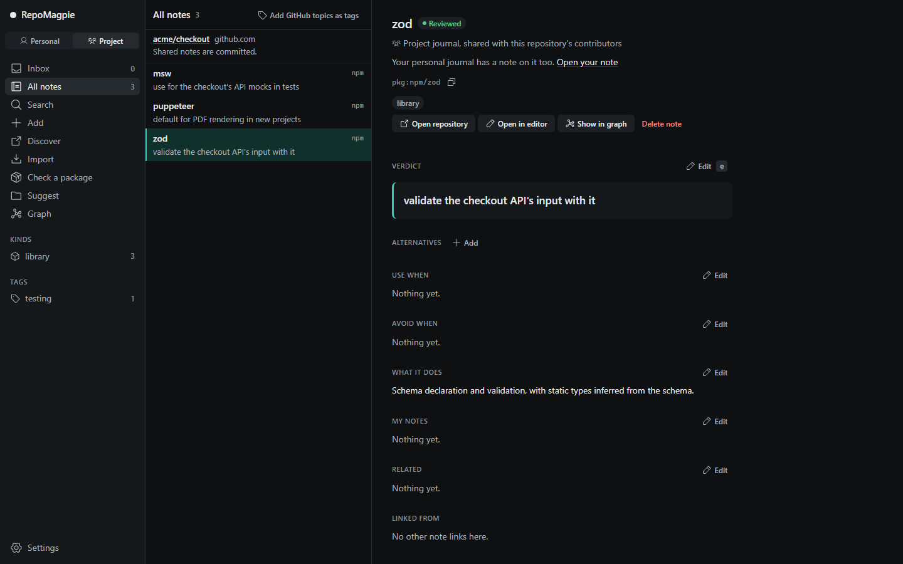

<div align="center">

[English](../../README.md) · [Türkçe](README_tr.md) · [Deutsch](README_de.md) · Español · [简体中文](README_zh-CN.md) · [日本語](README_ja.md)

_Esta es una traducción del README en inglés y puede ir por detrás de él; el README en inglés es el que manda. Traducida del README en inglés del 2026-11-05._


# RepoMagpie

### Tus notas sobre dependencias, consultadas antes de que tu agente de programación instale nada.

**Anota por qué dejaste un paquete. Tu agente lo lee antes de volver a instalar ese paquete.**

[](https://www.npmjs.com/package/repomagpie)
[](../spec.md#repomagpie-mcp)
[](#qué-recibe-cada-agente)
[](https://github.com/Varshavia/RepoMagpie/actions/workflows/ci.yml?query=branch%3Amain)
[](../../LICENSE)

[Inicio rápido](#inicio-rápido) · [Cómo funciona](#cómo-funciona) · [Qué recibe cada agente](#qué-recibe-cada-agente) · [Preguntas frecuentes](#preguntas-frecuentes) · [Documentación](#documentación)

<code>npm install -g repomagpie</code><br>
<code>repomagpie setup</code>

</div>

Hace meses probaste pdfkit y lo dejaste. Hoy tu agente está a punto de instalarlo otra vez, y en Claude Code el hook de RepoMagpie te pregunta primero, con tu propia nota:

```text
$ npm install pdfkit

RepoMagpie: you noted to avoid pdfkit (personal journal)
Verdict: "avoid: async streams painful; use puppeteer"
Alternatives in your personal journal: "puppeteer" (Verdict: "default for PDF rendering")
~/.magpie/notes/npm--pdfkit.md

Do you want to proceed?
```

- **Recordar:** escribe un Verdict (tu veredicto) en una línea: `repomagpie note pdfkit "avoid: async streams painful; use puppeteer"`. Tu agente también ofrece, una vez al final de una tarea, guardar una decisión sobre una dependencia con tu motivo. Las notas son archivos Markdown que te pertenecen.
- **Consultar antes de instalar:** cuando tu agente ejecuta `npm install pdfkit`, primero ve tu nota.
- **Buscar por tema:** pregunta por seguridad, bases de datos, pruebas… en cualquier idioma, y tu agente encuentra las notas que encajan, incluso las que no comparten ninguna palabra con tu pregunta.
- **Sugerir:** `repomagpie suggest` lee los manifiestos y el README de un proyecto, y lista las notas que encajan con él.
- **Descubrir:** busca en GitHub por palabras, tema y tipo, con estrellas y actividad reciente, y añade los repositorios que elijas a tu inbox (bandeja de entrada): `repomagpie discover`, o la aplicación. Las listas y los cursos quedan ocultos salvo que los pidas, y cada resultado dice por qué está ahí.
- **Empezar desde un proyecto:** `repomagpie init` lista las dependencias de un proyecto según lo que dicen tus notas y luego te pide tu Verdict para cada una que no tenga nota.

**Estado:** estable y en desarrollo activo. El [registro de cambios](../../CHANGELOG.md) lista cada versión; la [hoja de ruta](../roadmap.md) muestra lo que viene después.

## Inicio rápido

1. Instala el comando `repomagpie` y configúralo en tus agentes de programación:

   ```bash
   npm install -g repomagpie
   repomagpie setup
   ```

   `setup` muestra qué archivos va a cambiar, pregunta primero y hace una copia de seguridad de cada archivo que edita; `repomagpie setup --dry-run` solo muestra el plan ([agentes](../agents.md)).

2. Comprueba qué está conectado en cada agente:

   ```bash
   repomagpie doctor
   ```

   `doctor` también lista las copias de seguridad de `setup`, que pueden contener secretos de tus agentes ([SECURITY.md](../../SECURITY.md#what-repomagpie-reads-writes-and-sends)); `repomagpie setup --delete-backups` las borra.

3. Escribe tu primera nota. Una URL de GitHub también trae la licencia, los topics y los skills de agente del repositorio, y `--use-when` te permite encontrar la nota más tarde por lo que necesitas:

   ```bash
   repomagpie note pdfkit "avoid: async streams painful; use puppeteer" --type npm --alternative puppeteer
   repomagpie note https://github.com/microsoft/playwright-cli "use for agent browser tests" --use-when "an agent checks a web UI"
   ```

   Sin token, GitHub permite 60 solicitudes por hora. Para subir el límite, inicia sesión con GitHub CLI (`gh auth login`): RepoMagpie usa esa sesión. O define `GITHUB_TOKEN` o `GH_TOKEN`. `repomagpie doctor` dice cuál usa.

> [!IMPORTANT]
> RepoMagpie solo viene de [este repositorio](https://github.com/Varshavia/RepoMagpie), del paquete de npm [`repomagpie`](https://www.npmjs.com/package/repomagpie) y del skill de agente en [skills.sh](https://skills.sh/varshavia/repomagpie). No hay instaladores, ni `.exe` ni otras descargas, ni otros paquetes ni otro sitio web: cualquier otra cosa que se llame RepoMagpie no es nuestra ([SECURITY.md](../../SECURITY.md#official-channels)).

## Cómo funciona


Antes de una instalación, el skill le dice a tu agente que llame a `recall`, la herramienta MCP o el comando `repomagpie recall`. Cuando una nota dice que evites el paquete, tu agente te la muestra y te pregunta primero. El hook comprueba el propio comando de instalación, por si el agente se salta ese paso.

No hay ningún modelo adicional, ni clave de API, ni telemetría. RepoMagpie funciona tan bien como tu agente sigue el skill; sin hook, eso incluye la comprobación antes de una instalación.

## Pregúntale a tu agente

- **¿Qué tengo para pruebas en el navegador?** Tu agente busca en tus diarios y responde con las notas que encuentra, con el Verdict primero.
- **¿Cómo debería funcionar la seguridad de la base de datos en este proyecto?** Tu agente responde con tus notas de los dominios security y database que encajan con el proyecto, y dice por qué.
- **Instala pdfkit.** Tu agente lo consulta primero, te muestra tu nota de evitarlo con sus alternativas y te pregunta antes de instalar nada.
- **¿Cuáles de mis herramientas encajan con este proyecto?** `suggest` lee los manifiestos y el README del proyecto; tu agente elige las notas que encajan y nombra cualquier dependencia en uso que anotaste para evitar.

## Qué recibe cada agente

Lo que `repomagpie setup` configura en cada agente, en Linux, Windows o macOS con Node.js 22.12 o posterior ([agentes](../agents.md)):

| Agente | MCP | Skill | Hook | Cuando una nota dice que evites un paquete |
|---|---|---|---|---|
| Claude Code | sí | sí | sí | el hook te pregunta |
| Codex CLI | sí | sí | sí | el hook detiene el primer intento; tu agente te pregunta |
| Cursor | sí | sí | sí | el hook detiene el primer intento; tu agente te pregunta |
| Gemini CLI | sí | sí | sí | el hook te pregunta |
| VS Code (GitHub Copilot) | sí | sí | no | sin hook; el servidor MCP y el skill lo comprueban |
| Antigravity CLI | sí | sí | sí | el hook te pregunta |
| Copilot CLI | sí | sí | sí | el hook detiene el primer intento; tu agente te pregunta |

Codex CLI ejecuta un hook nuevo solo después de que confíes en él en `/hooks`. Otros agentes con MCP o [Agent Skills](https://agentskills.io) pueden usar el servidor o el skill: consulta [la configuración a mano](../setup-by-hand.md). El paquete no tiene dependencias en tiempo de ejecución, y las rutas con letras fuera de ASCII funcionan.

## Comparte notas con tu equipo

Un diario del proyecto es una carpeta `.magpie/` en el repositorio, que se hace commit junto con el código. El hook de RepoMagpie y `recall` la leen para cada colaborador, junto al diario propio de cada persona.

```sh
repomagpie note pdfkit "avoid: async streams painful; use puppeteer" --to project
git add .magpie && git commit -m "Add our note on pdfkit"
```

O copia ahí una de tus notas: `repomagpie adopt pdfkit`. Cuando el agente de un compañero está a punto de ejecutar `npm install pdfkit`, el hook le pregunta primero, y su `search` y su `suggest` también encuentran la nota. Cualquiera que pueda leer el repositorio puede leer sus notas.

En `repomagpie ui`, la vista Project nombra el repositorio y dice si sus notas compartidas tienen commit y push.



## La aplicación local

`repomagpie ui` abre tus diarios en el navegador. Search (Buscar) lista tus notas antes de que escribas, e Import (Importar) acepta una lista que pegues. Revisa una nota del inbox: escribe el Verdict, elige el tipo, los dominios, las etiquetas y la valoración, y pulsa Ctrl+Enter.


Check a package (Comprobar un paquete): lo que dicen tus diarios antes de una instalación y lo que hace el hook en cada agente.


Suggest for this project (Sugerencias para este proyecto): las notas que encajan y por qué cada una es candidata.


Mira un diario como un grafo: las notas, sus etiquetas, `[[links]]` y alternativas, coloreadas por dominio si quieres. Haz clic en una nota para leerla y editarla junto al grafo.


## En qué se diferencia

| Herramienta | Qué sabe | Cuándo la ves |
|---|---|---|
| Gestores de estrellas, como [Starcat](https://github.com/starcat-app/Starcat) y [GithubStarsManager](https://github.com/AmintaCCCP/GithubStarsManager) | Los repositorios a los que diste estrella, con etiquetas y notas | Cuando los buscas más tarde |
| Escáneres de la cadena de suministro, como [Socket Firewall Free](https://github.com/SocketDev/sfw-free) | Malware, vulnerabilidades y popularidad, a partir de datos globales | Antes de una instalación |
| RepoMagpie | Tus veredictos y los de tu equipo | Antes de una instalación, cuando buscas y cuando empiezas un proyecto |

Una línea como "avoid pdfkit" en `CLAUDE.md` cubre un proyecto. Una nota de RepoMagpie sirve en todos los proyectos, aparece en las búsquedas y el hook la comprueba en cada instalación. RepoMagpie no es un escáner: nunca afirma detectar malware ni vulnerabilidades, así que ejecuta uno junto a él ([visión](../vision.md#non-goals)).

## Preguntas frecuentes

<details>
<summary><strong>¿RepoMagpie envía mis notas a algún sitio?</strong></summary>

No. Tus diarios son archivos Markdown en tu equipo, y no hay telemetría. Las únicas solicitudes de red son llamadas de solo lectura a la API de GitHub, cuando añades una nota desde un repositorio de GitHub o buscas con `discover`: envían el nombre de ese repositorio o tu búsqueda, y tu token de GitHub si lo hay (`GITHUB_TOKEN`, `GH_TOKEN` o la sesión de GitHub CLI), nunca tus notas. `repomagpie ui` escucha solo en `127.0.0.1`. El proveedor del modelo de tu agente ve las notas que lee tu agente. Consulta [SECURITY.md](../../SECURITY.md#what-repomagpie-reads-writes-and-sends).

</details>

<details>
<summary><strong>¿RepoMagpie usa IA?</strong></summary>

No tiene un modelo propio: sus comandos comparan nombres y palabras, y no llaman a ningún modelo. La IA es el agente de programación que ya usas, que lee y guarda tus notas mediante el skill y las herramientas MCP. El skill le dice que nunca escriba tu Verdict por ti, que nunca borre una nota que no hayas nombrado y que nunca instale un paquete que anotaste para evitar sin preguntarte; un hook comprueba también esto último.

</details>

<details>
<summary><strong>¿El hook bloquea instalaciones?</strong></summary>

Nunca de forma definitiva, y nunca aprueba ninguna. Cuando una nota dice que evites el paquete, el hook te pregunta, o detiene el primer intento para que tu agente te pregunte ([la tabla](#qué-recibe-cada-agente)); después de una detención, la misma instalación pasa durante 10 minutos. Ninguna otra nota, ni un error en RepoMagpie, detiene nunca una instalación. Consulta el [contrato del hook](../spec.md#6-hook-contract).

</details>

<details>
<summary><strong>¿Cómo lo quito?</strong></summary>

Ejecuta `repomagpie setup --remove`. Solo quita las entradas MCP, los hooks y las carpetas de skills de RepoMagpie, nunca restaura una copia de seguridad encima de tus cambios posteriores, y deja tus diarios y las copias de seguridad de `setup`. Con `--agents`, la carpeta compartida del skill se queda mientras otro agente todavía la lea. Después, `repomagpie setup --delete-backups` borra las copias tras preguntarte, y `npm uninstall -g repomagpie` quita el comando.

</details>

<details>
<summary><strong>¿Puede un equipo acordar reglas con él?</strong></summary>

Sí. El diario del proyecto, `.magpie/` en el repositorio, se hace commit junto con el código, y el agente de cada persona del equipo lo lee después de `git pull`. Cuando una nota del proyecto y una nota personal no coinciden, manda la del proyecto. Revisen los cambios de reglas en pull requests y dejen que los responsables los aprueben con una línea en `CODEOWNERS`. Consulta [trabajar en equipo](../teams.md) (en inglés).

</details>

<details>
<summary><strong>¿Dónde están mis notas y puedo editarlas a mano?</strong></summary>

Cada nota es un archivo Markdown con frontmatter YAML, en `~/.magpie/notes/` o en el `.magpie/notes/` de un proyecto ([esquema de notas](../note-schema.md)). Edítalas en cualquier editor: RepoMagpie lee las notas escritas a mano aunque les falten campos o secciones, y nunca reescribe tus secciones. Define `MAGPIE_HOME` o pasa `--home` para guardar tu diario en otro lugar. `repomagpie delete` mueve una nota a la carpeta `.trash/` del diario.

</details>

## Documentación

- [Spec](../spec.md): cada comando, cada flag y cada documento `--json` (`repomagpie --help` lista los comandos)
- [Agentes](../agents.md): lo que admite cada agente de programación, y [la configuración a mano](../setup-by-hand.md)
- [Esquema de notas](../note-schema.md): el formato de una nota
- [La aplicación local](../ui.md): pantallas, API y reglas de seguridad
- [Probar la beta](../../TESTING.md): los pasos para una semana con la beta y cómo enviar comentarios
- [Visión](../vision.md), [competidores](../competitors.md) y [decisiones](../decisions/)

Abre un issue para errores e ideas. El proyecto todavía no acepta pull requests ([CONTRIBUTING.md](../../CONTRIBUTING.md)). Para informar de una vulnerabilidad, consulta [SECURITY.md](../../SECURITY.md).

## Licencia

[MIT](../../LICENSE) © 2026 Yusuf Suat Babacan
