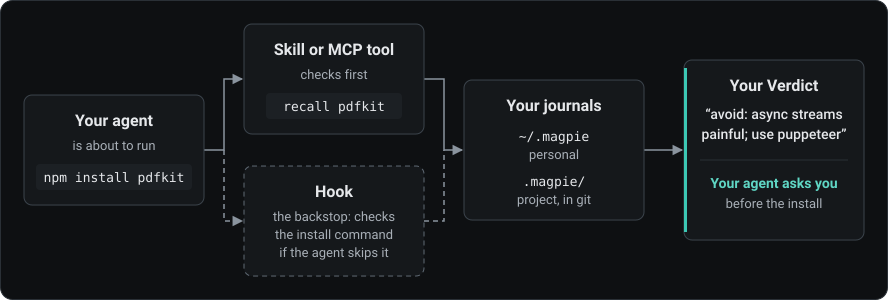

<div align="center">

[English](../../README.md) · [Türkçe](README_tr.md) · [Deutsch](README_de.md) · [Español](README_es.md) · [简体中文](README_zh-CN.md) · 日本語

_これは英語版 README の翻訳で、英語版より古い場合があります。正本は英語版 README です。2026-11-04 時点の英語版 README から翻訳しました。_


# RepoMagpie

### コーディングエージェントが何かをインストールする前に、あなたの依存関係メモを確認します。

**パッケージをやめた理由を書いておきましょう。エージェントはそのパッケージを再びインストールする前に、それを読みます。**

[](https://www.npmjs.com/package/repomagpie)
[](../spec.md#repomagpie-mcp)
[](#各エージェントに設定されるもの)
[](https://github.com/Varshavia/RepoMagpie/actions/workflows/ci.yml?query=branch%3Amain)
[](../../LICENSE)

[クイックスタート](#クイックスタート) · [仕組み](#仕組み) · [各エージェントに設定されるもの](#各エージェントに設定されるもの) · [よくある質問](#よくある質問) · [ドキュメント](#ドキュメント)

<code>npm install -g repomagpie@beta</code><br>
<code>repomagpie setup</code>

</div>

数か月前、あなたは pdfkit を試して使うのをやめました。今日、エージェントがそれをまたインストールしようとしています。Claude Code では、RepoMagpie のフックがあなた自身のメモを示して、先にあなたに確認します：

```text
$ npm install pdfkit

RepoMagpie: you noted to avoid pdfkit (personal journal)
Verdict: "avoid: async streams painful; use puppeteer"
Alternatives in your personal journal: "puppeteer" (Verdict: "default for PDF rendering")
~/.magpie/notes/npm--pdfkit.md

Do you want to proceed?
```

- **記録する：** Verdict（あなたの判断）を 1 行で書きます：`repomagpie note pdfkit "avoid: async streams painful; use puppeteer"`。エージェントもタスクの終わりに一度だけ、依存関係についての判断をあなたの理由とともに保存するよう提案します。メモはあなたが所有する Markdown ファイルです。
- **インストール前に思い出す：** エージェントが `npm install pdfkit` を実行するとき、まずあなたのメモを目にします。
- **関心事で探す：** セキュリティ、データベース、テストなどについてどの言語で尋ねても、エージェントは合うメモを見つけます。質問と共通する単語がひとつもないメモでも見つかります。
- **提案する：** `repomagpie suggest` はプロジェクトのマニフェストと README を読み、そのプロジェクトに合うメモを一覧にします。
- **発見する：** GitHub をキーワード、関心事、種類で検索し、スター数と最近の活動も確認して、選んだリポジトリを inbox（受信箱）に追加します：`repomagpie discover` またはアプリで行えます。リストやコースは求めない限り非表示で、各結果にはそれが表示される理由が示されます。
- **プロジェクトから始める：** `repomagpie init --auto` はプロジェクトの依存関係をあなたのメモの内容ごとに一覧にし、メモのないものそれぞれについてあなたの Verdict を尋ねます。

**ステータス：** 初期テスター向けのベータ版です。[変更履歴](../../CHANGELOG.md)にすべてのバージョンが載っています。今後の予定は[ロードマップ](../roadmap.md)をご覧ください。

## クイックスタート

1. `repomagpie` コマンドをインストールし、コーディングエージェントに設定します：

   ```bash
   npm install -g repomagpie@beta
   repomagpie setup
   ```

   `setup` は変更するファイルを示し、先に確認を求め、編集する各ファイルをバックアップします。`repomagpie setup --dry-run` は計画を表示するだけです（[エージェント](../agents.md)）。

2. 各エージェントで何が接続されているかを確認します：

   ```bash
   repomagpie doctor
   ```

   `doctor` は `setup` のバックアップも一覧にします。バックアップにはエージェントの機密情報が含まれることがあります（[SECURITY.md](../../SECURITY.md#what-repomagpie-reads-writes-and-sends)）。`repomagpie setup --delete-backups` で削除できます。

3. 最初のメモを書きます。GitHub の URL を指定すると、リポジトリのライセンス、トピック、エージェントスキルも取得します。`--use-when` を付けると、あとで必要なことからメモを探せます：

   ```bash
   repomagpie note pdfkit "avoid: async streams painful; use puppeteer" --type npm --alternative puppeteer
   repomagpie note https://github.com/microsoft/playwright-cli "use for agent browser tests" --use-when "an agent checks a web UI"
   ```

   トークンがない場合、GitHub が許可するリクエストは 1 時間に 60 回です。上限を上げるには GitHub CLI でサインインしてください（`gh auth login`）。RepoMagpie はそのログインを使います。または `GITHUB_TOKEN` か `GH_TOKEN` を設定します。どれを使っているかは `repomagpie doctor` が表示します。

> [!IMPORTANT]
> RepoMagpie の入手元は、[このリポジトリ](https://github.com/Varshavia/RepoMagpie)、npm パッケージ [`repomagpie`](https://www.npmjs.com/package/repomagpie)、[skills.sh](https://skills.sh/varshavia/repomagpie) のエージェントスキルだけです。インストーラー、`.exe` などのダウンロード、ほかのパッケージ、ほかのウェブサイトはありません。RepoMagpie を名乗るそれ以外のものは、私たちのものではありません（[SECURITY.md](../../SECURITY.md#official-channels)）。

## 仕組み



インストールの前に、スキルはエージェントに `recall`（MCP ツールまたは `repomagpie recall` コマンド）を呼ぶよう指示します。メモがそのパッケージを避けるよう言っている場合、エージェントはそのメモをあなたに見せ、先に確認します。エージェントがこの手順を飛ばした場合に備えて、フックがインストールコマンドそのものを確認します。

追加のモデル、API キー、テレメトリーはありません。RepoMagpie の効果は、エージェントがスキルにどれだけ従うかで決まります。フックがない場合は、インストール前の確認もそれに含まれます。

## エージェントに聞いてみる

- **ブラウザテストには何がある？** エージェントはあなたのジャーナル（journal）を検索し、見つかったメモを Verdict を先頭にして答えます。
- **このプロジェクトのデータベースのセキュリティはどうあるべき？** エージェントは security と database のドメインにあるメモのうちプロジェクトに合うもので答え、その理由を説明します。
- **pdfkit をインストールして。** エージェントはまず recall で確認し、避けるべきというあなたのメモを代替案とともに示し、何かをインストールする前にあなたに確認します。
- **このプロジェクトに合うツールはどれ？** `suggest` がプロジェクトのマニフェストと README を読みます。エージェントは合うメモを選び、使用中の依存関係のうち、あなたが避けるようメモしたものを挙げます。

## 各エージェントに設定されるもの

Linux、Windows、macOS で Node.js 22.12 以降を使う場合に、`repomagpie setup` が各エージェントに設定するもの（[エージェント](../agents.md)）：

| エージェント | MCP | スキル | フック | メモがパッケージを避けるよう言っている場合 |
|---|---|---|---|---|
| Claude Code | あり | あり | あり | フックがあなたに確認します |
| Codex CLI | あり | あり | あり | フックが最初の試行を止め、エージェントがあなたに確認します |
| Cursor | あり | あり | あり | フックが最初の試行を止め、エージェントがあなたに確認します |
| Gemini CLI | あり | あり | あり | フックがあなたに確認します |
| VS Code (GitHub Copilot) | あり | あり | なし | フックはありません。MCP サーバーとスキルが確認します |
| Antigravity CLI | あり | あり | あり | フックがあなたに確認します |
| Copilot CLI | あり | あり | あり | フックが最初の試行を止め、エージェントがあなたに確認します |

Codex CLI は、新しいフックを `/hooks` で信頼したあとでないと実行しません。MCP や [Agent Skills](https://agentskills.io) に対応するほかのエージェントも、サーバーやスキルを使えます：[手動セットアップ](../setup-by-hand.md)をご覧ください。このパッケージには実行時の依存関係がなく、ASCII 以外の文字を含むパスでも動作します。

## チームでメモを共有する

プロジェクトジャーナルはリポジトリ内の `.magpie/` フォルダーで、コードと一緒にコミットされます。RepoMagpie のフックと `recall` は、各メンバー自身のジャーナルと並べて、すべてのコントリビューターに対してそれを読みます。

```sh
repomagpie note pdfkit "avoid: async streams painful; use puppeteer" --to project
git add .magpie && git commit -m "Add our note on pdfkit"
```

または、自分のメモをそこにコピーします：`repomagpie adopt pdfkit`。チームメイトのエージェントが `npm install pdfkit` を実行しようとすると、フックがまずその人に確認し、その人の `search` と `suggest` もそのメモを見つけます。リポジトリを読める人は誰でも、そのメモを読めます。

## ローカルアプリ

`repomagpie ui` はあなたのジャーナルをブラウザで開きます。Search（検索）は入力する前からメモを一覧にし、Import（インポート）は貼り付けたリストを受け付けます。inbox のメモをレビューします：Verdict を書き、種類、ドメイン、タグ、評価を設定して、Ctrl+Enter を押します。


Check a package（パッケージを確認）：インストールの前にジャーナルが何と言っているか、そして各エージェントでフックが何をするか。


Suggest for this project（このプロジェクトへの提案）：合うメモと、それぞれが候補である理由。


ジャーナルをグラフで見られます：メモ、そのタグ、`[[links]]`、代替案を表示し、必要ならドメインごとに色分けします。メモをクリックすると、グラフの横で読んで編集できます。


## ほかのツールとの比較

| ツール | 知っていること | 目にするタイミング |
|---|---|---|
| スター管理ツール（[Starcat](https://github.com/starcat-app/Starcat)、[GithubStarsManager](https://github.com/AmintaCCCP/GithubStarsManager) など） | スターを付けたリポジトリと、そのタグやメモ | あとで検索するとき |
| サプライチェーンスキャナー（[Socket Firewall Free](https://github.com/SocketDev/sfw-free) など） | 世界規模のデータに基づくマルウェア、脆弱性、人気度 | インストールの前 |
| RepoMagpie | あなたとチームの判断 | インストールの前、検索するとき、プロジェクトを始めるとき |

`CLAUDE.md` に書いた "avoid pdfkit" のような 1 行は、1 つのプロジェクトにしか効きません。RepoMagpie のメモはプロジェクトをまたいで効き、検索にも表示され、フックがインストールのたびに確認します。RepoMagpie はスキャナーではありません。マルウェアや脆弱性を検出するとは決して主張しないので、スキャナーも併用してください（[ビジョン](../vision.md#non-goals)）。

## よくある質問

<details>
<summary><strong>RepoMagpie はメモをどこかに送りますか？</strong></summary>

いいえ。ジャーナルはあなたのマシン上の Markdown ファイルで、テレメトリーはありません。ネットワークリクエストは、GitHub リポジトリからメモを追加するときや `discover` で検索するときの、GitHub API への読み取り専用の呼び出しだけです。送られるのはそのリポジトリ名か検索内容と、GitHub トークンがあればそのトークン（`GITHUB_TOKEN`、`GH_TOKEN`、または GitHub CLI のログイン）で、メモが送られることはありません。`repomagpie ui` は `127.0.0.1` でのみ待ち受けます。エージェントが読んだメモは、そのエージェントのモデル提供元にも見えます。[SECURITY.md](../../SECURITY.md#what-repomagpie-reads-writes-and-sends) をご覧ください。

</details>

<details>
<summary><strong>RepoMagpie は AI を使いますか？</strong></summary>

独自のモデルは使いません。コマンドは名前と単語を照合するだけで、モデルを呼び出しません。AI はあなたがすでに使っているコーディングエージェントで、スキルと MCP ツールを通じてメモを読み、保存します。スキルはエージェントに対して、あなたの代わりに Verdict を書かないこと、あなたが名前を挙げていないメモを削除しないこと、避けるようメモしたパッケージをあなたに確認せずにインストールしないことを指示します。最後の点はフックも確認します。

</details>

<details>
<summary><strong>フックはインストールをブロックしますか？</strong></summary>

永続的にブロックすることはなく、承認することもありません。メモがそのパッケージを避けるよう言っている場合、フックはあなたに確認するか、最初の試行を止めてエージェントがあなたに確認するようにします（[表](#各エージェントに設定されるもの)）。止めたあと 10 分間は、同じインストールが通ります。それ以外のメモや RepoMagpie のエラーで、インストールが止まることはありません。[フックの仕様](../spec.md#6-hook-contract)をご覧ください。

</details>

<details>
<summary><strong>どうやって削除しますか？</strong></summary>

`repomagpie setup --remove` を実行します。RepoMagpie 自身の MCP エントリー、フック、スキルフォルダーだけを取り除き、あとから加えた変更の上にバックアップを書き戻すことはなく、ジャーナルと `setup` のバックアップは残します。`--agents` を付けた場合、共有のスキルフォルダーは、ほかのエージェントがまだ読んでいる間は残ります。そのあと `repomagpie setup --delete-backups` が確認のうえバックアップを削除し、`npm uninstall -g repomagpie` がコマンドを削除します。

</details>

<details>
<summary><strong>メモはどこにありますか？手で編集できますか？</strong></summary>

各メモは YAML フロントマター付きの Markdown ファイルで、`~/.magpie/notes/` またはプロジェクトの `.magpie/notes/` にあります（[メモのスキーマ](../note-schema.md)）。どのエディターでも編集できます。RepoMagpie は、フィールドやセクションが欠けていても手書きのメモを読み、あなたのセクションを書き換えることはありません。ジャーナルを別の場所に置くには、`MAGPIE_HOME` を設定するか `--home` を渡します。`repomagpie delete` はメモをジャーナルの `.trash/` フォルダーに移動します。

</details>

## ドキュメント

- [Spec](../spec.md)：すべてのコマンド、フラグ、`--json` ドキュメント（`repomagpie --help` でコマンドを一覧できます）
- [エージェント](../agents.md)：各コーディングエージェントが対応している内容と、[手動セットアップ](../setup-by-hand.md)
- [メモのスキーマ](../note-schema.md)：メモの形式
- [ローカルアプリ](../ui.md)：画面、API、セキュリティのルール
- [ベータ版のテスト](../../TESTING.md)：ベータ版を 1 週間使う手順と、フィードバックの送り方
- [ビジョン](../vision.md)、[競合](../competitors.md)、[意思決定](../decisions/)

バグやアイデアは issue でお知らせください。このプロジェクトはまだプルリクエストを受け付けていません（[CONTRIBUTING.md](../../CONTRIBUTING.md)）。脆弱性の報告については [SECURITY.md](../../SECURITY.md) をご覧ください。

## ライセンス

[MIT](../../LICENSE) © 2026 Yusuf Suat Babacan
