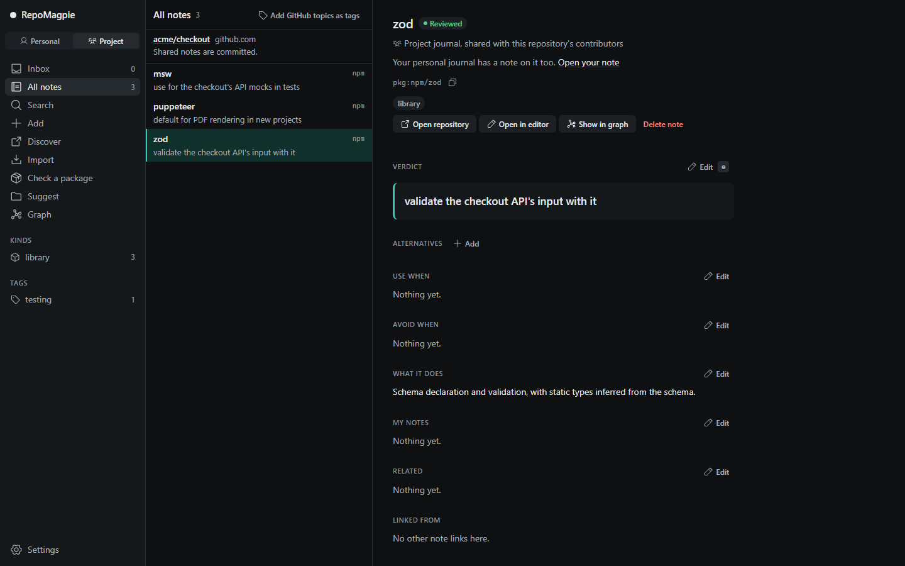

<div align="center">

[English](../../README.md) · Türkçe · [Deutsch](README_de.md) · [Español](README_es.md) · [简体中文](README_zh-CN.md) · [日本語](README_ja.md)

_Bu, İngilizce README'nin çevirisidir ve ondan geride kalabilir; esas metin İngilizce olandır. Çevrildiği metin: 2026-11-07 tarihli İngilizce README._


# RepoMagpie

### Kodlama ajanın denediğin depoları ve onlar hakkında ne düşündüğünü hatırlar.

**RepoMagpie, denediğin açık kaynak depoların ve araçların (kütüphaneler, CLI'lar, MCP sunucuları, ajan skill'leri) kişisel günlüğüdür; her birinde kendi kararın yazılıdır. Kodlama ajanın bir araç seçmeden önce ona bakar: işine yarayanları önerir, elediklerinde durur.**

[](https://www.npmjs.com/package/repomagpie)
[](../spec.md#repomagpie-mcp)
[](#her-ajan-ne-alır)
[](https://github.com/Varshavia/RepoMagpie/actions/workflows/ci.yml?query=branch%3Amain)
[](../../LICENSE)

[Hızlı başlangıç](#hızlı-başlangıç) · [Nasıl çalışır](#nasıl-çalışır) · [Her ajan ne alır](#her-ajan-ne-alır) · [SSS](#sss) · [Belgeler](#belgeler)

<code>npm install -g repomagpie</code><br>
<code>repomagpie setup</code>

</div>

Aylar önce pdfkit'i denemiş, sonra vazgeçmiştin. Bugün ajanın onu yeniden kurmak üzere; Claude Code'da RepoMagpie'nin hook'u, senin notunla önce sana soruyor:

```text
$ npm install pdfkit

RepoMagpie: you noted to avoid pdfkit (personal journal)
Verdict: "avoid: async streams painful; use puppeteer"
Alternatives in your personal journal: "puppeteer" (Verdict: "default for PDF rendering")
~/.magpie/notes/npm--pdfkit.md

Do you want to proceed?
```

- **Not al:** denediğin her depo ve araç için kararını kendi sözlerinle yaz: ne zaman kullanılır, ne zaman kaçınılır, yerine ne kullanılır. `repomagpie note pdfkit "avoid: async streams painful; use puppeteer"` bir not yazar; ajanın da bir işin sonunda, bir kararı senin nedeninle kaydetmeyi bir kez önerir. Her not, sahibi olduğun bir Markdown dosyasıdır.
- **Hatırla:** ajanın bir araç seçmeden önce, skill ve MCP sunucusu üzerinden bu kararlara bakar. "Tarayıcı testleri için neyim var?" diye istediğin dilde sor ya da `repomagpie suggest` bir projeye uyan notları listelesin. Ajanın elediğin bir şeyi kurmaya kalkarsa hook onu durdurur, böylece önce sana sorulur.
- **Keşfet:** GitHub'da kelimeyle, ilgi alanıyla ve türle yeni depolar bul, onları kendi yorumunla günlüğüne ekle: `repomagpie discover` ya da uygulama. Her sonuç neden orada olduğunu söyler.

[Yedi kodlama ajanında](#her-ajan-ne-alır) çalışır; aralarında Claude Code, Codex CLI, Cursor ve Gemini CLI var. Her şey yerelde kalır: makinendeki düz Markdown dosyaları; hesap yok, bulut sunucusu yok. Ekipler için aynı notlar depoda durabilir ve git ile paylaşılabilir ([aşağıda](#notlarını-ekibinle-paylaş)).

**Durum:** kararlı sürüm, geliştirme sürüyor. [Değişiklik kaydı](../../CHANGELOG.md) her sürümü listeler; [yol haritası](../roadmap.md) sırada ne olduğunu gösterir.

## Hızlı başlangıç

1. `repomagpie` komutunu yükle ve kodlama ajanlarında ayarla:

   ```bash
   npm install -g repomagpie
   repomagpie setup
   ```

   `setup` hangi dosyaları değiştireceğini gösterir, önce sorar ve düzenlediği her dosyanın yedeğini alır; `repomagpie setup --dry-run` yalnızca planı gösterir ([ajanlar](../agents.md)).

2. Her ajanda neyin bağlı olduğunu kontrol et:

   ```bash
   repomagpie doctor
   ```

   `doctor`, `setup`'ın yedeklerini de listeler; bu yedekler ajanlarının gizli bilgilerini içerebilir ([SECURITY.md](../../SECURITY.md#what-repomagpie-reads-writes-and-sends)). `repomagpie setup --delete-backups` onları siler.

3. İlk notunu yaz. Bir GitHub URL'si deponun lisansını, konularını (topics) ve ajan skill'lerini de çeker; `--use-when` ise notu sonra neye ihtiyacın olduğuyla bulmanı sağlar:

   ```bash
   repomagpie note pdfkit "avoid: async streams painful; use puppeteer" --type npm --alternative puppeteer
   repomagpie note https://github.com/microsoft/playwright-cli "use for agent browser tests" --use-when "an agent checks a web UI"
   ```

   Token olmadan GitHub saatte 60 isteğe izin verir. Sınırı yükseltmek için GitHub CLI ile giriş yap (`gh auth login`): RepoMagpie onun girişini kullanır. Ya da `GITHUB_TOKEN` veya `GH_TOKEN` ayarla. Hangisini kullandığını `repomagpie doctor` söyler.

> [!IMPORTANT]
> RepoMagpie yalnızca üç yerden gelir: [bu depo](https://github.com/Varshavia/RepoMagpie), [`repomagpie`](https://www.npmjs.com/package/repomagpie) npm paketi ve [skills.sh](https://skills.sh/varshavia/repomagpie) üzerindeki ajan skill'i. Kurulum programı, `.exe` ya da başka bir indirme, başka bir paket ve başka bir web sitesi yoktur: kendine RepoMagpie diyen başka her şey bizim değildir ([SECURITY.md](../../SECURITY.md#official-channels)).

## Nasıl çalışır


Ajanın bir araç seçmeden önce skill, ona günlüklerine bakmasını söyler: seçerken `search` ya da `suggest`, kurulumdan önce `recall`; MCP araçları ya da `repomagpie` komutları olarak. Önce senin kararların gelir. İşine yarayanlar önerilir; bir not paketten kaçınmanı söylüyorsa ajanın notu sana gösterir ve önce sorar. Ajan bu adımı atlarsa diye hook, kurulum komutunun kendisini kontrol eder.

Ek bir model, API anahtarı ya da telemetri yoktur. RepoMagpie, ajanın skill'e uyduğu kadar işe yarar; hook yoksa bu, kurulumdan önceki kontrol için de geçerlidir.

## Ajanına sor

- **What do I have for browser testing?** (Tarayıcı testi için elimde ne var?) Ajanın günlüklerinde arar ve bulduğu notlarla, Verdict'i başta olmak üzere yanıt verir.
- **Veritabanı güvenliği bu projede nasıl olmalı?** Ajanın, security ve database alanlarındaki notlarından projeye uyanlarla yanıt verir ve nedenini söyler.
- **Install pdfkit.** (pdfkit'i kur.) Ajanın önce pdfkit'e dair notlarına bakar, kaçınma notunu alternatifleriyle gösterir ve bir şey kurmadan önce sana sorar.
- **Which of my tools fit this project?** (Araçlarımdan hangileri bu projeye uyar?) `suggest` projenin manifest dosyalarını ve README'sini okur; ajanın uyan notları seçer ve projede kullanılan, kaçınmayı not ettiğin bağımlılıkları belirtir.

## Her ajan ne alır

`repomagpie setup`'ın Linux, Windows ya da macOS'ta, Node.js 22.12 veya üstüyle her ajanda ayarladıkları ([ajanlar](../agents.md)):

| Ajan | MCP | Skill | Hook | Bir not paketten kaçınmanı söylediğinde |
|---|---|---|---|---|
| Claude Code | evet | evet | evet | hook sana sorar |
| Codex CLI | evet | evet | evet | hook ilk denemeyi durdurur; ajanın sana sorar |
| Cursor | evet | evet | evet | hook ilk denemeyi durdurur; ajanın sana sorar |
| Gemini CLI | evet | evet | evet | hook sana sorar |
| VS Code (GitHub Copilot) | evet | evet | hayır | hook yok; MCP sunucusu ve skill kontrol eder |
| Antigravity CLI | evet | evet | evet | hook sana sorar |
| Copilot CLI | evet | evet | evet | hook ilk denemeyi durdurur; ajanın sana sorar |

Codex CLI yeni bir hook'u ancak sen ona `/hooks` içinde güvendikten sonra çalıştırır. MCP ya da [Agent Skills](https://agentskills.io) destekleyen diğer ajanlar sunucuyu ya da skill'i kullanabilir: [elle kurulum](../setup-by-hand.md) sayfasına bak. Paketin çalışma zamanı bağımlılığı yoktur ve ASCII dışında harfler içeren yollar çalışır.

## Notlarını ekibinle paylaş

Proje günlüğü, depodaki bir `.magpie/` klasörüdür ve kodla birlikte commit'lenir. RepoMagpie'nin hook'u ve `recall` onu her katkıcı için, kişinin kendi günlüğünün yanında okur.

```sh
repomagpie note pdfkit "avoid: async streams painful; use puppeteer" --to project
git add .magpie && git commit -m "Add our note on pdfkit"
```

Ya da kendi notlarından birini oraya kopyala: `repomagpie adopt pdfkit`. Bir ekip arkadaşının ajanı `npm install pdfkit` çalıştırmak üzereyken hook önce ona sorar; onun `search` ve `suggest` komutları da notu bulur. Depoyu okuyabilen herkes notlarını da okuyabilir.

`repomagpie ui`'da Project görünümü deponun adını verir ve paylaşılan notların commit ve push edilip edilmediğini söyler.



## Yerel uygulama

`repomagpie ui` günlüklerini tarayıcıda açar. Search (Arama) sen yazmadan önce notlarını listeler, Import (İçe aktar) yapıştırdığın bir listeyi alır. Gelen kutusundaki (Inbox) bir notu gözden geçir: Verdict'i yaz, türü, alanları, etiketleri ve puanı seç, Ctrl+Enter'a bas.


Bir paketi kontrol et (Check a package): kurulumdan önce günlüklerinin ne dediği ve hook'un her ajanda ne yaptığı.


Bu proje için öneri (Suggest for this project): uyan notlar ve her birinin neden aday olduğu.


Bir günlüğü grafik olarak gör: notlar, etiketleri, `[[links]]` ve alternatifler; istersen alana göre renkli. Bir nota tıkla, grafiğin yanında oku ve düzenle.


## Benzerleriyle karşılaştırma

| Araç | Ne bilir | Ne zaman görürsün |
|---|---|---|
| Yıldız yöneticileri, örneğin [Starcat](https://github.com/starcat-app/Starcat) ve [GithubStarsManager](https://github.com/AmintaCCCP/GithubStarsManager) | Yıldızladığın depolar, etiketleri ve notlarıyla | Daha sonra aradığında |
| Tedarik zinciri tarayıcıları, örneğin [Socket Firewall Free](https://github.com/SocketDev/sfw-free) | Küresel verilerden kötü amaçlı yazılım, güvenlik açıkları ve popülerlik | Bir kurulumdan önce |
| RepoMagpie | Senin ve ekibinin kararları | Bir kurulumdan önce, arama yaptığında ve bir projeye başladığında |

`CLAUDE.md` içindeki "avoid pdfkit" gibi bir satır tek bir projeyi kapsar. Bir RepoMagpie notu bütün projelerinde geçerlidir, aramada çıkar ve hook onu her kurulumda kontrol eder. Oturum ya da sohbet belleği değildir: araçlar hakkında senin yazdığın kararları hatırlar. Bir yıldız listesinde ya da awesome listesinde ajanının kullanabileceği bir görüş yoktur; bir notta vardır. RepoMagpie bir tarayıcı değildir: kötü amaçlı yazılım ya da güvenlik açığı bulduğunu asla iddia etmez; yanında bir tarayıcı çalıştır ([vizyon](../vision.md#non-goals)).

## SSS

<details>
<summary><strong>RepoMagpie notlarımı bir yere gönderiyor mu?</strong></summary>

Hayır. Günlüklerin makinendeki Markdown dosyalarıdır ve telemetri yoktur. Tek ağ istekleri GitHub'ın API'sine yapılan salt okuma çağrılarıdır: bir GitHub deposundan not eklediğinde ya da `discover` ile aradığında. Bunlar o deponun adını ya da aramanı, varsa GitHub token'ını (`GITHUB_TOKEN`, `GH_TOKEN` ya da GitHub CLI girişi) gönderir, notlarını asla göndermez. `repomagpie ui` yalnızca `127.0.0.1` üzerinde dinler. Ajanının okuduğu notları ajanın model sağlayıcısı da görür. [SECURITY.md](../../SECURITY.md#what-repomagpie-reads-writes-and-sends) sayfasına bak.

</details>

<details>
<summary><strong>RepoMagpie yapay zekâ kullanıyor mu?</strong></summary>

Kendine ait bir model kullanmaz: komutları adları ve kelimeleri eşleştirir, hiçbir modeli çağırmaz. Yapay zekâ, zaten kullandığın kodlama ajanıdır; notlarını skill ve MCP araçları üzerinden okur ve kaydeder. Skill ona Verdict'ini asla senin yerine yazmamasını, adını vermediğin bir notu asla silmemesini ve kaçınmayı not ettiğin bir paketi sana sormadan asla kurmamasını söyler; bu sonuncusunu bir hook da kontrol eder.

</details>

<details>
<summary><strong>Hook kurulumları engelliyor mu?</strong></summary>

Hiçbir kurulumu kalıcı olarak engellemez ve hiçbirini onaylamaz. Bir not paketten kaçınmanı söylediğinde hook sana sorar ya da ilk denemeyi durdurur ve ajanın sana sorar ([tablo](#her-ajan-ne-alır)); bir durdurmadan sonra aynı kurulum 10 dakika boyunca geçer. Başka bir not ya da RepoMagpie'deki bir hata hiçbir kurulumu durdurmaz. [Hook sözleşmesine](../spec.md#6-hook-contract) bak.

</details>

<details>
<summary><strong>Nasıl kaldırırım?</strong></summary>

`repomagpie setup --remove` çalıştır. Yalnızca RepoMagpie'nin kendi MCP girdilerini, hook'larını ve skill klasörlerini kaldırır, sonradan yaptığın değişikliklerin üzerine asla bir yedeği geri yüklemez; günlüklerini ve `setup`'ın yedeklerini bırakır. `--agents` ile, ortak skill klasörü başka bir ajan onu hâlâ okuyorsa yerinde kalır. Sonra `repomagpie setup --delete-backups` sorduktan sonra yedekleri siler, `npm uninstall -g repomagpie` de komutu kaldırır.

</details>

<details>
<summary><strong>Bir ekip onunla kurallarda anlaşabilir mi?</strong></summary>

Evet. Proje günlüğü, depodaki `.magpie/`, kodla birlikte commit'lenir ve her ekip arkadaşının ajanı `git pull` sonrası onu okur. Proje notuyla kişisel bir not çeliştiğinde proje notu geçerlidir. Kural değişikliklerini pull request'lerde gözden geçirin ve bir `CODEOWNERS` satırıyla onayı liderlere bırakın. Bkz. [ekip olarak çalışmak](../teams.md) (İngilizce).

</details>

<details>
<summary><strong>Notlarım nerede, onları elle düzenleyebilir miyim?</strong></summary>

Her not, YAML frontmatter'ı olan bir Markdown dosyasıdır: `~/.magpie/notes/` içinde ya da bir projenin `.magpie/notes/` klasöründe ([not şeması](../note-schema.md)). Onları herhangi bir editörde düzenle: RepoMagpie, alanları ya da bölümleri eksik olsa da elle yazılmış notları okur ve senin bölümlerini asla yeniden yazmaz. Günlüğünü başka bir yerde tutmak için `MAGPIE_HOME`'u ayarla ya da `--home` ver. `repomagpie delete` bir notu günlüğün `.trash/` klasörüne taşır.

</details>

## Belgeler

Belgeler İngilizcedir.

- [Spec](../spec.md): her komut, bayrak ve `--json` belgesi (`repomagpie --help` komutları listeler)
- [Ajanlar](../agents.md): her kodlama ajanının neyi desteklediği ve [elle kurulum](../setup-by-hand.md)
- [Not şeması](../note-schema.md): bir notun biçimi
- [Yerel uygulama](../ui.md): ekranlar, API ve güvenlik kuralları
- [Betayı test etmek](../testing/TESTING_tr.md): beta ile bir haftanın adımları ve geri bildirimin nasıl gönderileceği
- [Vizyon](../vision.md), [rakipler](../competitors.md) ve [kararlar](../decisions/)

Hatalar ve fikirler için bir issue aç. Proje henüz pull request kabul etmiyor ([CONTRIBUTING.md](../../CONTRIBUTING.md)). Bir güvenlik açığı bildirmek için [SECURITY.md](../../SECURITY.md) sayfasına bak.

## Lisans

[MIT](../../LICENSE) © 2026 Yusuf Suat Babacan
