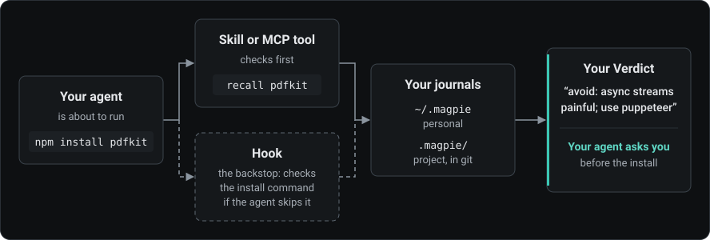

<div align="center">

[English](../../README.md) · [Türkçe](README_tr.md) · [Deutsch](README_de.md) · [Español](README_es.md) · 简体中文 · [日本語](README_ja.md)

_本文是英文 README 的翻译，可能落后于英文版；以英文 README 为准。译自 2026-11-04 的英文 README。_


# RepoMagpie

### 你的依赖笔记，在编程智能体安装任何东西之前先被查看。

**写下你为什么放弃了一个包。你的智能体在再次安装这个包之前会读到它。**

[](https://www.npmjs.com/package/repomagpie)
[](../spec.md#repomagpie-mcp)
[](#每个智能体得到什么)
[](https://github.com/Varshavia/RepoMagpie/actions/workflows/ci.yml?query=branch%3Amain)
[](../../LICENSE)

[快速开始](#快速开始) · [工作原理](#工作原理) · [每个智能体得到什么](#每个智能体得到什么) · [常见问题](#常见问题) · [文档](#文档)

<code>npm install -g repomagpie@beta</code><br>
<code>repomagpie setup</code>

</div>

几个月前你试过 pdfkit，后来放弃了。今天你的智能体又要安装它，而在 Claude Code 中，RepoMagpie 的 hook（钩子）会带着你自己的笔记先问你：

```text
$ npm install pdfkit

RepoMagpie: you noted to avoid pdfkit (personal journal)
Verdict: "avoid: async streams painful; use puppeteer"
Alternatives in your personal journal: "puppeteer" (Verdict: "default for PDF rendering")
~/.magpie/notes/npm--pdfkit.md

Do you want to proceed?
```

- **记录：** 用一行写下 Verdict（你的结论）：`repomagpie note pdfkit "avoid: async streams painful; use puppeteer"`。你的智能体也会在一个任务结束时提出一次，把这次关于依赖的决定连同你的理由一起保存。笔记是归你所有的 Markdown 文件。
- **安装前提醒：** 当你的智能体运行 `npm install pdfkit` 时，它会先看到你的笔记。
- **按关注点查找：** 用任何语言询问安全、数据库、测试……你的智能体会找到相关的笔记，即使它们和你的问题没有一个相同的词。
- **推荐：** `repomagpie suggest` 读取项目的清单文件和 README，列出适合它的笔记。
- **发现：** 按关键词、关注点和类型搜索 GitHub，附带星标数和近期活跃度，并把你选中的仓库加入 inbox（收件箱）：使用 `repomagpie discover` 或应用。除非你要求，列表和课程会被隐藏，每个结果都会说明它为什么出现。
- **从项目开始：** `repomagpie init` 按照你的笔记所说列出项目的依赖，然后对每个还没有笔记的依赖询问你的 Verdict。

**状态：** beta 版，面向早期测试者。[更新日志](../../CHANGELOG.md)列出每个版本；[路线图](../roadmap.md)展示接下来的计划。

## 快速开始

1. 安装 `repomagpie` 命令，并在你的编程智能体中完成设置：

   ```bash
   npm install -g repomagpie@beta
   repomagpie setup
   ```

   `setup` 会显示它将修改哪些文件，先征求你的同意，并备份它编辑的每个文件；`repomagpie setup --dry-run` 只显示计划（[智能体](../agents.md)）。

2. 检查每个智能体中已接入了什么：

   ```bash
   repomagpie doctor
   ```

   `doctor` 还会列出 `setup` 的备份，这些备份可能包含你的智能体的机密信息（[SECURITY.md](../../SECURITY.md#what-repomagpie-reads-writes-and-sends)）；`repomagpie setup --delete-backups` 会删除它们。

3. 写下你的第一条笔记。GitHub URL 还会获取仓库的许可证、topics 和智能体 skill，`--use-when` 让你以后能按需求找到这条笔记：

   ```bash
   repomagpie note pdfkit "avoid: async streams painful; use puppeteer" --type npm --alternative puppeteer
   repomagpie note https://github.com/microsoft/playwright-cli "use for agent browser tests" --use-when "an agent checks a web UI"
   ```

   没有 token 时，GitHub 每小时允许 60 次请求。要提高限额，请用 GitHub CLI 登录（`gh auth login`）：RepoMagpie 会使用它的登录状态。也可以设置 `GITHUB_TOKEN` 或 `GH_TOKEN`。`repomagpie doctor` 会告诉你它用的是哪一个。

> [!IMPORTANT]
> RepoMagpie 只来自[这个仓库](https://github.com/Varshavia/RepoMagpie)、npm 包 [`repomagpie`](https://www.npmjs.com/package/repomagpie) 和 [skills.sh](https://skills.sh/varshavia/repomagpie) 上的智能体 skill。没有安装程序，没有 `.exe` 或其他下载，没有其他包，也没有其他网站：任何其他自称 RepoMagpie 的东西都不是我们的（[SECURITY.md](../../SECURITY.md#official-channels)）。

## 工作原理



在安装之前，skill 会让你的智能体调用 `recall`，即 MCP 工具或 `repomagpie recall` 命令。当一条笔记说要避免这个包时，你的智能体会把它展示给你并先询问你。hook 会检查安装命令本身，以防智能体跳过这一步。

没有额外的模型，没有 API 密钥，也没有遥测。RepoMagpie 的效果取决于你的智能体遵循 skill 的程度；没有 hook 时，安装前的检查也是如此。

## 问问你的智能体

- **我有什么可以用来做浏览器测试？** 你的智能体会搜索你的笔记库（journal），用找到的笔记回答，Verdict 在前。
- **这个项目中的数据库安全应该怎么做？** 你的智能体会用你在 security 和 database 领域中适合这个项目的笔记来回答，并说明原因。
- **安装 pdfkit。** 你的智能体会先查一下它，展示你那条要避免它的笔记及其替代方案，并在安装任何东西之前询问你。
- **我的哪些工具适合这个项目？** `suggest` 读取项目的清单文件和 README；你的智能体挑选合适的笔记，并指出项目中正在使用、而你记录过要避免的依赖。

## 每个智能体得到什么

`repomagpie setup` 在 Linux、Windows 或 macOS 上、使用 Node.js 22.12 或更高版本时为每个智能体设置的内容（[智能体](../agents.md)）：

| 智能体 | MCP | Skill | Hook | 当笔记说要避免某个包时 |
|---|---|---|---|---|
| Claude Code | 是 | 是 | 是 | hook 询问你 |
| Codex CLI | 是 | 是 | 是 | hook 拦下第一次尝试；你的智能体询问你 |
| Cursor | 是 | 是 | 是 | hook 拦下第一次尝试；你的智能体询问你 |
| Gemini CLI | 是 | 是 | 是 | hook 询问你 |
| VS Code (GitHub Copilot) | 是 | 是 | 否 | 没有 hook；由 MCP 服务器和 skill 检查 |
| Antigravity CLI | 是 | 是 | 是 | hook 询问你 |
| Copilot CLI | 是 | 是 | 是 | hook 拦下第一次尝试；你的智能体询问你 |

Codex CLI 只有在你于 `/hooks` 中信任新的 hook 之后才会运行它。其他支持 MCP 或 [Agent Skills](https://agentskills.io) 的智能体可以使用服务器或 skill：参见[手动设置](../setup-by-hand.md)。这个包没有运行时依赖，包含非 ASCII 字母的路径也能正常工作。

## 与团队共享笔记

项目笔记库是仓库中的一个 `.magpie/` 文件夹，与代码一起提交。RepoMagpie 的 hook 和 `recall` 会为每位贡献者读取它，同时读取每个人自己的笔记库。

```sh
repomagpie note pdfkit "avoid: async streams painful; use puppeteer" --to project
git add .magpie && git commit -m "Add our note on pdfkit"
```

或者把你自己的某条笔记复制过去：`repomagpie adopt pdfkit`。当队友的智能体要运行 `npm install pdfkit` 时，hook 会先询问他们，他们的 `search` 和 `suggest` 也能找到这条笔记。任何能读取这个仓库的人都能读取其中的笔记。

## 本地应用

`repomagpie ui` 在浏览器中打开你的笔记库。Search（搜索）在你输入之前就列出你的笔记，Import（导入）接受你粘贴的列表。审阅 inbox 中的一条笔记：写下 Verdict，设置类型、领域、标签和评分，然后按 Ctrl+Enter。


Check a package（检查一个包）：安装前你的笔记库怎么说，以及 hook 在每个智能体中会做什么。


Suggest for this project（为这个项目推荐）：适合的笔记，以及每条为什么是候选。


以图的形式查看笔记库：笔记、它们的标签、`[[links]]` 和替代方案，可以按领域着色。点击一条笔记，就能在图旁边阅读和编辑它。


## 与同类工具对比

| 工具 | 它知道什么 | 你何时看到 |
|---|---|---|
| 星标管理器，例如 [Starcat](https://github.com/starcat-app/Starcat) 和 [GithubStarsManager](https://github.com/AmintaCCCP/GithubStarsManager) | 你加过星标的仓库，以及标签和笔记 | 你之后搜索它们时 |
| 供应链扫描器，例如 [Socket Firewall Free](https://github.com/SocketDev/sfw-free) | 来自全球数据的恶意软件、漏洞和流行度 | 安装之前 |
| RepoMagpie | 你和团队的结论 | 安装之前、搜索时，以及开始一个项目时 |

`CLAUDE.md` 中像 "avoid pdfkit" 这样的一行只覆盖一个项目。RepoMagpie 的笔记跨项目有效，会出现在搜索中，hook 会在每次安装时检查它。RepoMagpie 不是扫描器：它从不声称能检测恶意软件或漏洞，所以请在它旁边再运行一个扫描器（[愿景](../vision.md#non-goals)）。

## 常见问题

<details>
<summary><strong>RepoMagpie 会把我的笔记发送到别处吗？</strong></summary>

不会。你的笔记库是你机器上的 Markdown 文件，也没有遥测。唯一的网络请求是对 GitHub API 的只读调用，发生在你从 GitHub 仓库添加笔记或用 `discover` 搜索时：它们发送该仓库的名称或你的搜索内容，如果有 GitHub token 也会发送（`GITHUB_TOKEN`、`GH_TOKEN` 或 GitHub CLI 的登录状态），但从不发送你的笔记。`repomagpie ui` 只监听 `127.0.0.1`。你的智能体的模型提供商能看到你的智能体读取的笔记。参见 [SECURITY.md](../../SECURITY.md#what-repomagpie-reads-writes-and-sends)。

</details>

<details>
<summary><strong>RepoMagpie 使用 AI 吗？</strong></summary>

它没有自己的模型：它的命令只匹配名称和词语，不调用任何模型。AI 是你已经在用的编程智能体，它通过 skill 和 MCP 工具读取并保存你的笔记。skill 告诉它：绝不替你写 Verdict，绝不删除你没有点名的笔记，绝不在不问你的情况下安装你记录过要避免的包；最后这一点也由 hook 检查。

</details>

<details>
<summary><strong>hook 会阻止安装吗？</strong></summary>

从不永久阻止，也从不批准安装。当一条笔记说要避免这个包时，hook 会询问你，或者拦下第一次尝试，让你的智能体来询问你（[见表格](#每个智能体得到什么)）；拦下之后，同样的安装在 10 分钟内可以通过。其他任何笔记，或者 RepoMagpie 自身的错误，都不会拦下安装。参见 [hook 约定](../spec.md#6-hook-contract)。

</details>

<details>
<summary><strong>如何移除它？</strong></summary>

运行 `repomagpie setup --remove`。它只移除 RepoMagpie 自己的 MCP 条目、hook 和 skill 文件夹，从不用备份覆盖你之后做的修改，并保留你的笔记库和 `setup` 的备份。使用 `--agents` 时，只要还有其他智能体在读取共享的 skill 文件夹，它就会保留。之后，`repomagpie setup --delete-backups` 会在询问后删除备份，`npm uninstall -g repomagpie` 会移除命令。

</details>

<details>
<summary><strong>团队可以用它约定规则吗？</strong></summary>

可以。项目笔记库，即仓库中的 `.magpie/`，与代码一起提交；每位团队成员的智能体在 `git pull` 之后都会读取它。项目笔记与个人笔记冲突时，以项目笔记为准。在 pull request 中审查规则的修改，并用 `CODEOWNERS` 中的一行让负责人来批准。参见[团队协作](../teams.md)（英文）。

</details>

<details>
<summary><strong>我的笔记在哪里？可以手动编辑吗？</strong></summary>

每条笔记是一个带 YAML frontmatter 的 Markdown 文件，位于 `~/.magpie/notes/` 或项目的 `.magpie/notes/` 中（[笔记格式](../note-schema.md)）。可以用任何编辑器编辑：即使缺少字段或章节，RepoMagpie 也能读取手写的笔记，并且从不改写你的章节。设置 `MAGPIE_HOME` 或传入 `--home`，就能把笔记库放在别处。`repomagpie delete` 会把笔记移到笔记库的 `.trash/` 文件夹。

</details>

## 文档

- [Spec](../spec.md)：每个命令、参数和 `--json` 文档（`repomagpie --help` 列出所有命令）
- [智能体](../agents.md)：每个编程智能体支持什么，以及[手动设置](../setup-by-hand.md)
- [笔记格式](../note-schema.md)：笔记的格式
- [本地应用](../ui.md)：界面、API 和安全规则
- [测试 beta 版](../../TESTING.md)：使用 beta 版一周的步骤，以及如何发送反馈
- [愿景](../vision.md)、[竞品](../competitors.md)和[决策](../decisions/)

报告 bug 和提出想法请开 issue。本项目暂不接受 pull request（[CONTRIBUTING.md](../../CONTRIBUTING.md)）。报告安全漏洞请参见 [SECURITY.md](../../SECURITY.md)。

## 许可证

[MIT](../../LICENSE) © 2026 Yusuf Suat Babacan
